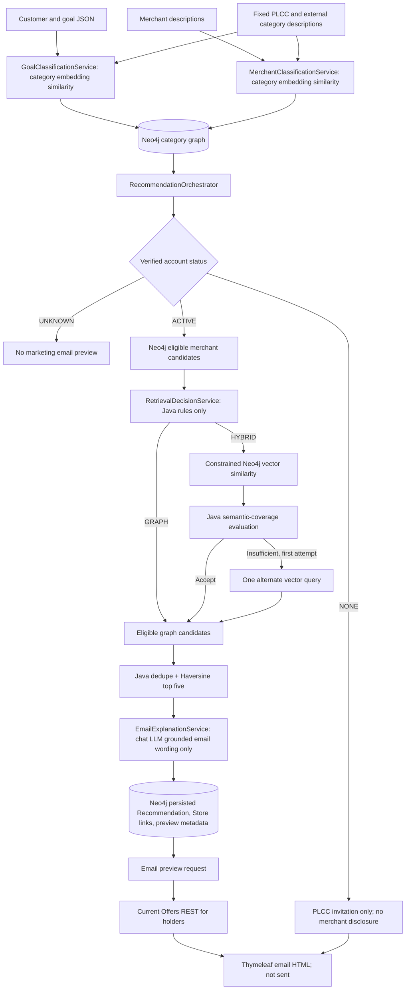

# LifeSync PLCC v0.7 — Java retrieval and email-only chat LLM

## Facts vs choices

1. Neo4j stores `Customer → Goal → Category ← Merchant → Store` and PLCC category support.
2. Neo4j supplies candidates; Java validates active status and PLCC account eligibility.
3. Java `RetrievalDecisionService` chooses GRAPH or HYBRID and decides if the optional second vector query is useful. No chat-model calls occur in this stage.
4. Embeddings (`nomic-embed-text`) support classification and optional semantic retrieval; embedding models are not chat-generation LLM agents.
5. Java fixes the final eligible store set and distance-based order.
6. The **only** chat LLM call is `EmailExplanationService` for the email introduction and merchant-specific prose. The email text is generated at recommendation-processing time and stored in the Recommendation/RECOMMENDS graph facts for later preview.
7. Offers are retrieved only on email preview for verified holders, never stored as graph nodes; no emails are sent.

## Guardrails

- PLCC eligibility, account holder checks, consent and merchant disclosure never depend on LLM output.
- Unsupported categories cannot become PLCC merchants simply due to semantic similarity.
- No vector result can bypass graph eligibility.
- If vectors are unavailable, graph-only fallback remains available.
- Graph/semantic threshold choices are POC heuristics, not measured accuracy or financial suitability conclusions.
- Only derived email wording comes from the chat model; Java validates the merchant IDs, reasons and returned structure.
- Distances are synthetic straight-line measurements, not driving time or verified shop availability.
- Reprocessing a previous goal rewrites the `Recommendation` node with Java decision metadata.

## Natural-language graph search (v0.8)

- `GraphSearchController` provides `/graph-search`: customer ID -> scoped goals -> optional question -> verified result cards.
- `NaturalLanguageGraphSearchService` is a **bounded LLM intent interpreter**, NOT a text-to-Cypher executor. LLM output contains only query mode and IDs of goals given as input. Java rejects IDs outside the customer scope.
- Repository queries use the existing customer-goal-category-merchant-store model. For active holders, previously persisted recommendations are preferred; incomplete goals may display clearly labeled live eligible candidates.
- Chat-model use is now **two distinct activities**: (1) natural-language query interpretation, (2) grounded email wording. Java still owns classification-category validation, graph querying, eligibility and ranking. Embeddings power semantic classification and optional text-query fallback.
- **Security boundary for demo:** customer ID is an untrusted input, not proof of authorization. Enforce proper identity and account authorization before production use. Non-holders and UNKNOWN accounts receive no merchant details.
