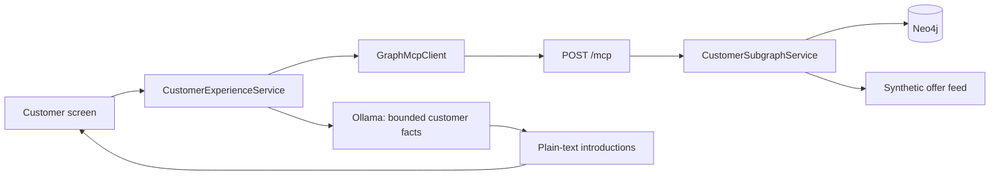

# Multi-product customer experience (v0.9)

The default landing page is a synthetic customer-ID lookup and comparison screen.
It is **not authentication**. The same screen can switch customer or filter product.
The previous PLCC automation and email preview UI remains under `/automation` for
compatibility; the new experience neither generates nor sends email.

## Run and validate

Use Java 21 JDK and Gradle 8.14.3:

```sh
gradle test bootJar
docker compose up -d neo4j ollama
UI_CONTENT_ENABLED=false java -jar build/libs/lifesync-java-poc-0.9.0.jar
python3 scripts/smoke-products.py
```

To download both legacy models with Compose, run
`docker compose --profile models run --rm pull-models` after allowing the model
registry and blob hosts. The app no longer waits on this optional download job;
missing chat models produce factual UI templates.

Start commands run from the checkout root. The application binds to loopback by
default. Compose explicitly sets its internal address to `0.0.0.0` but publishes
only loopback ports. The graph MCP client defaults to the same process at
`http://127.0.0.1:8080/mcp`; configure `GRAPH_MCP_URL` when the service is elsewhere
or when changing the application port.

The new curated fixtures do not require model downloads. For LLM-generated UI
introductions, pull `qwen2.5:1.5b` into Ollama and set `UI_CONTENT_ENABLED=true`
(the default). If generation is disabled, unavailable, malformed, contains unknown
goal IDs, or exceeds the bounded prompt budget, factual templates render the same
goals, provider order and offers. Generated prose is plain text, not trusted HTML.

`LEGACY_INGESTION_ENABLED=true` opts into the older semantic-only ingestion of
`customers.json`, `goals.json` and `merchants.json`; that requires
`nomic-embed-text`. Existing legacy goals already in Neo4j are included by the MCP
projection as PLCC goals. The older processing scheduler is off by default;
`SCHEDULER_ENABLED=true` enables it for the legacy workflow.

In the managed cloud environment, Gradle and JDK installations are under
`/workspace/tools`, with `GRADLE_USER_HOME=/workspace/gradle-home`.
Use `-Djavax.net.ssl.trustStore=/etc/ssl/certs/java/cacerts` for Gradle HTTPS.
The environment setup draft contains complete installation steps and the needed
Ollama registry/blob network destinations. Network policy must be applied before
model pulls can succeed; do not disable TLS checks.

## Synthetic data and graph

`data/input/products-demo.json` contains four products, three new customers,
twelve goals and twelve fictional providers across Seattle, Bellevue and Tacoma:

| Product | Categories | Provider meaning |
| --- | --- | --- |
| PLCC | HOME_FURNISHINGS, APPLIANCES, ELECTRONICS; plus legacy PLCC categories | Retail merchants |
| HOME_PURCHASE | HOME_PURCHASE | Home lending providers |
| HOME_REFINANCE | HOME_REFINANCE | Refinance providers |
| AUTO_LOAN | AUTO_LOAN | Auto finance providers |

Demo IDs: `C-DEMO-001` (ACTIVE PLCC), `C-DEMO-002` (NONE),
`C-DEMO-003` (UNKNOWN). Each has a goal for every product. Product/category
assignments in this file are curated synthetic facts, not AI classification or
credit decisions. Startup upserts are repeatable and preserve existing customer
and goal fixtures under their separate IDs.



Graph relationships:

```text
(Customer)-[:HAS_GOAL]->(Goal)-[:FOR_PRODUCT]->(Product)
(Goal)-[:CLASSIFIED_AS]->(Category)<-[:SUPPORTS_CATEGORY]-(Product)
(Merchant)-[:OFFERS_CATEGORY]->(Category)
(Merchant)-[:SERVES_PRODUCT]->(Product)
(Merchant)-[:HAS_STORE]->(Store)
```

The read query starts with a customer-goal ownership edge, checks product/category
support and active providers, and applies the existing ACTIVE-account gate only
to PLCC. Lending matches indicate product relevance and do not imply loan
eligibility. Missing coordinates or missing matches yield explicit empty states.
The MCP projection returns all goals up to a demo limit of 200 and at most five
providers per goal. Larger customer graphs return an error, not a silently
truncated list. Requests never accept Cypher or generated queries.

## Offers and ranking

`data/input/product-offers.json` is an external synthetic offer feed, re-read on
lookup; offers are not persisted in Neo4j. The feed includes merchant-wide and
customer-specific offers plus an expired record to exercise exclusion.

* Providers: nearest five by unrounded Haversine straight-line miles, with stable
  store-ID tie breaking. Coordinates are synthetic, not verified storefronts.
* PLCC offers within each provider: highest discount first.
* Loan offers within each provider: lowest illustrative APR, then fees.
* Only active, in-date, product-matched, merchant-matched and audience-matched
  offers with valid numeric terms are shown. At most three offers per provider.
* Loan term and fees remain visible: APR ranking is not a total-cost comparison
  or a suitability recommendation. Discounts and APRs are never compared across
  products. Missing offers show an explicit empty state.

## MCP integration

Endpoint: `POST /mcp`. Stateless MCP Streamable HTTP, JSON response mode,
protocol version `2025-03-26`. No session ID or SSE subscription is required.
GET is unsupported (405), as allowed for a server without streaming.

Supports `initialize`, `notifications/initialized`, `ping`, `tools/list`
and `tools/call`. Tool: `get_customer_subgraph`.

```json
{
  "jsonrpc": "2.0",
  "id": 2,
  "method": "tools/call",
  "params": {
    "name": "get_customer_subgraph",
    "arguments": {
      "customerId": "C-DEMO-001",
      "productId": "HOME_PURCHASE"
    }
  }
}
```

Omit `productId` to load all products. Call initialize and send the initialized
notification first. Send `Accept: application/json, text/event-stream` and
`MCP-Protocol-Version: 2025-03-26` on subsequent requests. The tool's text content
is a JSON customer subgraph: goals, products, categories, providers and offers.
The server was checked with the official Python MCP SDK in this environment.

Example client:

```python
from mcp import ClientSession
from mcp.client.streamable_http import streamablehttp_client

async def lookup():
    async with streamablehttp_client("http://127.0.0.1:8080/mcp") as (read, write, _):
        async with ClientSession(read, write) as session:
            await session.initialize()
            return await session.call_tool("get_customer_subgraph", {
                "customerId": "C-DEMO-001", "productId": "AUTO_LOAN"
            })
```

The UI service uses this HTTP MCP interface, not a direct repository call.
Only the returned customer's goal/provider/offer projection enters the LLM;
customer display names, IDs, ECNs, account status, exact coordinates and
personalized-offer customer IDs are excluded from its prompt.
Java owns eligibility, ranking and numeric offer terms. The LLM cannot modify
the graph and no tools are exposed to it.

This is a local synthetic demo. For shared or production access, put the UI and
MCP service behind real authentication and authorization, derive permitted
customers from the authenticated principal, and add role-controlled staff
lookup. A caller-supplied customer ID is never proof of access. Origin checks
on MCP are defense in depth, not an authorization system.
