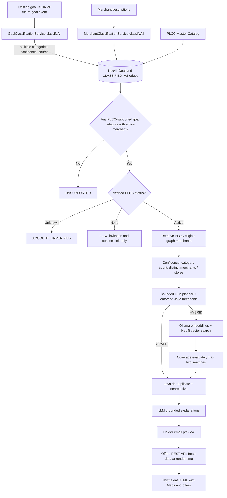

> Historical reference for v0.4; current v0.7 behavior is documented in `../README.md` and `architecture.md`.

# LifeSync v0.4: Multi-category classification and explainable retrieval planning

## Invariants

1. Only categories linked to `PLCC-[:SUPPORTS_CATEGORY]->(:Category)` can produce merchant recommendations or invitations.
2. All retrieval (including ANN vector results) must match `Goal-[:CLASSIFIED_AS]->Category<-[:OFFERS_CATEGORY]-Merchant` and PLCC category eligibility.
3. An LLM cannot choose GRAPH when the evidence policy requires HYBRID, but a missing vector model can force GRAPH fallback.
4. Java ranks the top five geocoded stores by distance, even when vector similarity is used for filtering.
5. PLCC non-holders never retrieve merchant store details or call Offers; unknown account status blocks previews.
6. Offers are retrieved from REST on each holder preview and are not persisted to Neo4j.

## Planner example

A goal *Buy a sofa and laptop* with categories `HOME_FURNISHINGS,ELECTRONICS`, classification confidence `0.82`, 8 graph-eligible merchants and 10 eligible stores yields `HYBRID` because categoryCount > 1 and confidence < 0.85. An LLM suggestion of `GRAPH` is overridden, recorded as `POLICY_ENFORCED`, and shown in the goal page.

A goal *Buy a refrigerator* with one category, confidence `0.95`, at least 3 graph-eligible merchants and vector enabled defaults to `GRAPH`, but the LLM may request `HYBRID` to investigate a stated semantic ambiguity. An unavailable LLM uses the deterministic default.

**Caveat:** Confidence and similarity thresholds are demonstration heuristics. This is not a production marketing eligibility engine or verified financial suitability assessment.
